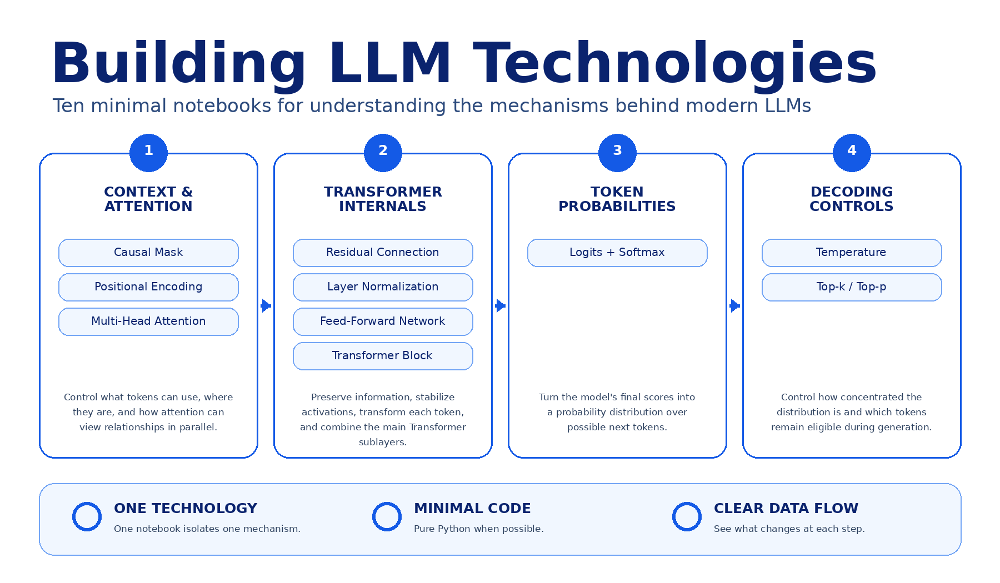

# Building LLM Technologies


[](LICENSE)


A collection of minimal educational notebooks that isolate and explain core technologies used inside modern LLMs.

Each version focuses on one mechanism, uses small numbers and short code, and prefers pure Python whenever a library would hide the concept being studied.

> **One notebook, one technology, one clear idea.**



## Project goal

The goal is not to build another complete language model. The companion project [Building LLM](https://github.com/lucalullo/building-llm) already follows that path from statistical counts to a small decoder-only Transformer.

**Building LLM Technologies** takes the opposite approach: it isolates individual mechanisms so they can be understood independently.

The notebooks answer questions such as:

- Why does a decoder-only LLM need a causal mask?
- How does the model represent token order?
- Why are multiple attention heads useful?
- What do residual connections and LayerNorm do?
- What happens inside a Transformer block?
- How do logits become probabilities?
- How do temperature, top-k and top-p affect generation?

## Technologies

| Version | Technology | Main idea |
|---|---|---|
| 1 | Causal Mask | Prevent attention from using future positions |
| 2 | Positional Encoding | Add sequence-position information to token representations |
| 3 | Multi-Head Attention | Use multiple attention views in parallel |
| 4 | Residual Connection | Preserve the previous representation while adding new information |
| 5 | Layer Normalization | Keep internal activations on a stable scale |
| 6 | Feed-Forward Network | Transform each token independently after attention |
| 7 | Transformer Block | Combine attention, residuals, normalization and feed-forward processing |
| 8 | Logits and Softmax | Turn model scores into next-token probabilities |
| 9 | Temperature | Rescale logits before softmax to control distribution sharpness |
| 10 | Top-k and Top-p Sampling | Restrict the candidate tokens used for generation |

## Conceptual flow

```text
Input tokens
    ↓
Positional information
    ↓
Transformer processing
    ├── Causal Mask
    ├── Multi-Head Attention
    ├── Residual Connection
    ├── Layer Normalization
    └── Feed-Forward Network
    ↓
Transformer Block output
    ↓
Logits
    ↓
Temperature scaling
    ↓
Softmax probabilities
    ↓
Top-k / Top-p filtering
    ↓
Next-token selection
```

## Repository structure

```text
Building LLM Technologies/
├── v1-causal-mask/
│   └── building-llm-technologies.ipynb
├── v2-positional-encoding/
│   └── building-llm-technologies.ipynb
├── v3-multi-head-attention/
│   └── building-llm-technologies.ipynb
├── v4-residual-connection/
│   └── building-llm-technologies.ipynb
├── v5-layer-normalization/
│   └── building-llm-technologies.ipynb
├── v6-feed-forward-network/
│   └── building-llm-technologies.ipynb
├── v7-transformer-block/
│   └── building-llm-technologies.ipynb
├── v8-logits-and-softmax/
│   └── building-llm-technologies.ipynb
├── v9-temperature/
│   └── building-llm-technologies.ipynb
├── v10-top-k-and-top-p-sampling/
│   └── building-llm-technologies.ipynb
├── infographic.png
├── project-report-en.pdf
├── project-report-it.pdf
├── README.md
├── LICENSE
└── .gitignore
```

## How to use the project

The notebooks are intentionally independent. You can follow them in order or open only the technology you want to review.

Most examples use standard Python. The calculations are deliberately small enough to inspect manually.

Start Jupyter:

```bash
jupyter notebook
```

Then open any version folder and run the notebook from top to bottom.

## Educational simplifications

The examples are intentionally smaller than production implementations:

- positional vectors are simplified to make the idea visible rather than reproduce sinusoidal encoding, learned production embeddings or RoPE;
- the multi-head notebook uses illustrative attention weights to show that different heads can focus differently; its final combination is a conceptual simplification rather than a complete learned Q/K/V and value-projection pipeline;
- Layer Normalization is reduced to mean/variance standardization and omits the small epsilon term and learned scale/shift parameters used in full implementations;
- the Transformer Block notebook focuses on the order and role of the sublayers; it is a data-flow sketch and does not reproduce every matrix operation already isolated in the Feed-Forward Network notebook;
- logits in the decoding notebooks are manually chosen to isolate softmax, temperature and filtering mechanisms;
- temperature is applied to logits before softmax;
- the top-k/top-p notebook demonstrates candidate filtering; a full sampler would normally renormalize the remaining probabilities and then sample from them.

These simplifications are deliberate. The purpose is to expose the role of each technology, not reproduce a production LLM implementation.

## Documentation

The repository includes two general reports:

- [Project report - English](project-report-en.pdf)
- [Relazione del progetto - Italiano](project-report-it.pdf)

It also includes a general infographic:

- [Building LLM Technologies infographic](infographic.png)

## Relationship with Building LLM

This repository is a companion to [Building LLM](https://github.com/lucalullo/building-llm).

```text
Building LLM
→ build a language model progressively

Building LLM Technologies
→ isolate and understand the mechanisms used by LLMs
```

The first project focuses on evolution of a complete model. This project focuses on understanding individual technologies with minimal examples.

## Status

**The 10-version educational roadmap is complete.**

Future additions should only be made when a new mechanism can be explained with the same minimal, focused approach.

## License

This project is distributed under the [MIT License](LICENSE).

## Author

Created by [Luca Lullo](https://github.com/lucalullo).
